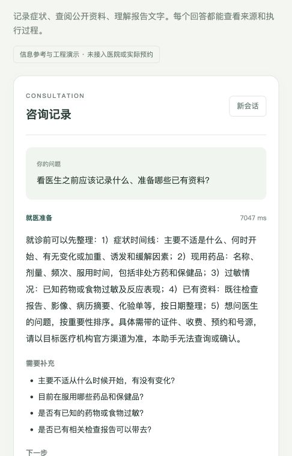

# MedAgent Runtime

面向个人项目的医疗信息 Multi-Agent 运行时。按医疗需求规格重新实现后端、界面、角色规则和测试；使用 AI 辅助开发。支持症状记录、公开药品资料、报告文字咨询及就医准备，不接入医院系统。

项目仓库：[xuyul6/med-agent-runtime-v1](https://github.com/xuyul6/med-agent-runtime-v1)。

## 请求链路

```text
风险门 → 会话隔离 → 三路意图融合 → 角色与实例选择
       → 受控工具 / 多路检索 → 角色并行执行 → 引用与输出校验
       → 协作汇总 → Redis 会话 / ChromaDB 摘要 → 脱敏 Trace
```

- `symptom_guide`：整理症状和报告信息，不给疾病结论或未经来源支持的科室判断。
- `drug_reference`：查找公开药品资料，说明地区、人群和资料完整性。
- `visit_guide`：整理就医资料与待问问题，不创建预约。
- `general`：介绍范围并澄清需求。
- `risk_handoff`：固定风险提示，先于模型及存储执行；没有真实人工连接。

## 本地启动

Python 3.12、Node.js 20.19+ 或 22.12+、Docker。

```bash
cd backend
python3.12 -m venv .venv
source .venv/bin/activate
python -m pip install -r requirements-dev.txt
cp .env.example .env.local
# 设置模型密钥、模型 ID、Redis 密码及对应 Redis URL。
cd ..
docker compose --env-file backend/.env.local up -d redis chroma
cd backend
python -m uvicorn medagent.app:app --host 127.0.0.1 --port 8000
```

另开终端：

```bash
cd frontend
npm ci
npm run dev
```

默认工作台 `http://localhost:5173`，API 文档 `http://localhost:8000/docs`。前端通过 `/api` 代理请求；可用 `VITE_API_TARGET` 更改开发代理地址。密钥只能放在后端忽略的配置中。

离线预览：后端设置 `MAR_PREVIEW=true`，使用固定预览输出、字符哈希向量及内存会话，明确标识为预览，不计量真实模型效果。线上向量模式为 `MAR_EMBEDDINGS=onnx`，首次需要下载 Chroma 官方模型缓存。

全栈容器入口：`docker compose --env-file backend/.env.local up -d --build`。容器 API 和工作台端口只绑定回环地址；镜像构建结果以[验证记录](docs/verification.md)为准。

## 验证

```bash
# backend/
python -m pytest tests/ -q
python -m medagent.evaluate --url http://127.0.0.1:8000 --output artifacts/evaluation.json
# 可选：真实上下文对比，会产生额外模型费用。
python -m medagent.benchmark --url http://127.0.0.1:8000 --output artifacts/context.json
# frontend/
npm test
npm run build
```

评测调用与工作台相同的 `/chat` 链路。规则检查、Judge 分数和解析失败分别记录。Token 对比区分准备会话与目标轮用量；尚未证明质量等价时不据此宣称节省收益。本版本不继承其他实现的测试数量或评测成绩。

## 边界与资料

本项目只用于虚构资料工程演示；不诊断、不开处方、不提供个人剂量或真实预约。没有完整账户认证、删除界面、医院接口、OCR 或临床验证。Redis 会话 TTL 为24小时，压缩摘要在 ChromaDB 持久化；请勿输入真实健康隐私。

药品种子仅为来源导读，没有完整说明书与相互作用数据库。公开资料默认草稿，核对后才允许检索；允许检索不等于临床审核。工具层为内部执行器，没有实现外部 MCP 协议连接。

详见[架构说明](docs/architecture.md)、[资料来源](THIRD_PARTY.md)、[沟通模板](docs/consultation-template.md)、[验证记录](docs/verification.md)和[贡献指南](AGENTS.md)。


