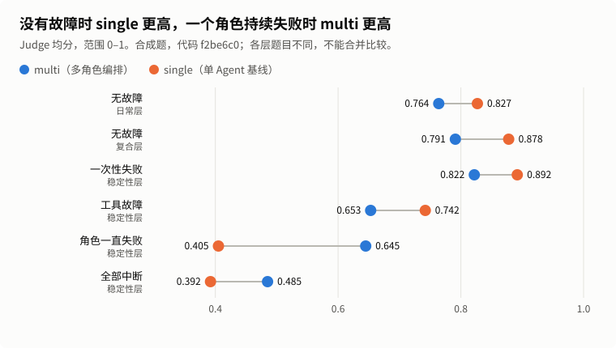

# MedAgent Runtime

一个以健康信息咨询为场景的多 Agent 编排运行时。每次请求先经过不依赖模型的急症规则筛选，再识别意图（模型在这一步也能把请求升级为急症，但不能降级），并决定交给一个角色处理还是多个角色并行。每个角色只能使用自己领域的工具和资料，输出经过校验后合并，再写回按用户和咨询对象隔离的记忆。全过程留下 Trace，进入监控和评测。

这是个人工程项目，**不是经过临床验证的医疗服务**：不诊断、不处方、不决定个人剂量，也没有接入医院、预约、急救调度或人工客服。演示请使用虚构信息。项目使用 AI 辅助开发。

## 一次请求怎么走

```text
急症筛选 ─┬─ 命中急症 → 确定性求助提示（不调用模型、检索和存储）
          └─ 其他 → 意图识别 → 路由决策 → 单角色 / 多角色并行执行 → 合并 → 记忆回写
                                                                          ↓
                                       监控（实例健康度 → 下一次路由） · 评测（红队集、回归 → 规则修改）
```

| 阶段 | 做什么 | 代码 |
| --- | --- | --- |
| 急症筛选 | 按体征表述、上下文排除（否定、既往、假设、虚构、比喻等）判定 `CRITICAL / CAUTION / ROUTINE`。命中急症时直接返回求助提示；之后 30 分钟内，同一会话里接着描述情况的消息仍按急症处理。规则没命中时，意图识别的模型调用可以摘录用户本轮原话发出急症信号，摘录对得上原话才升级；模型只能升级、不能降级，失败时只用规则。 | `understanding/risk.py`、`understanding/classification.py` |
| 意图识别 | 关键词和模型两路打分，加一份固定的均匀先验，按 0.35 / 0.45 / 0.20 加权融合；模型不可用时其余两项重新归一化。原先第三路是向量相似度，实测没有区分作用，已去除，先验保留它的权重，阈值行为不变。少量显式规则会覆盖融合结果，比如续问沿用上一任务、本轮明确给出药名。同时抽取药名、报告项目等字段，只接受能在用户原话里找到的值，并记录出处轮次。“是不是在查某个具体产品”“是不是涉及就医”这两个判断也由模型做：模型摘出本轮原话作为依据，代码核对原话确实在用户输入里才采用；模型不可用或摘录对不上时退回原来的词表。用户给了产品名或规格时，照旧只查产品标签。 | `understanding/classification.py`、`conversation.py`、`medications.py` |
| 路由决策 | 某个领域必须在本轮有任务证据才放行：旧对话里的字段不能单独激活角色，只是顺带提到的药名或报告（如“在吃布洛芬”）也不算任务。候选角色按意图 0.40、任务匹配 0.20、字段完整度 0.15、业务规则 0.10、实例健康度 0.15 打分，最多 1 个主角色加 2 个辅助角色。每个候选的分项和落选原因都写进 Trace。 | `understanding/routing.py` |
| 执行 | 多个角色并行执行，有并发上限和整体时限。每个角色有两个实例，失败或超时时换同角色的另一个实例，不让别的角色代答。配置 `DEEPSEEK_API_KEY` 后第二个实例改用 DeepSeek，只在第一个实例失败或被监控排除时才运行，这时角色请求（含用户原话）会发给 DeepSeek；没有配置时两个实例都用主模型。备用模型的输出靠提示词约束加本地校验，模拟主模型故障的小规模实测里 10 个角色任务完成 9 个，1 个输出格式不合格。角色内部依次做字段预检、检索、上下文工具、模型生成（最多两轮工具调用），最后校验输出；格式类错误允许修正一次。 | `runtime.py`、`agents/execution.py`、`tools/registry.py` |
| 合并 | 以主角色的回答为主体，辅助角色的回答作为分节。合并时模型只能调整已有分节的顺序，不能新增内容。会检查角色之间的字段冲突和引用版本冲突。主任务失败时如实说明，不让其他角色顶替。 | `agents/collaboration.py`、`agents/checks.py` |
| 记忆回写 | 按（用户、会话、咨询对象）的哈希隔离。Redis 保存最近消息和带出处的字段，有效期 24 小时；较长的对话压缩成摘要存进 Chroma，下次在同一作用域内召回。 | `memory.py` |
| 监控与评测 | 记录每个角色实例和工具的成功率与延迟。持续不达标的实例在路由中降权或暂停，之后用正常请求做恢复探测。评测包括离线测试、风险红队集、真实模型回归和 LLM-as-Judge。 | `monitoring.py`、`evaluation/` |

离线预览模式下的路由结果（未调用模型，所以意图识别只有关键词和先验）：

```text
"我头痛两天了，想整理一下症状，顺便查一下布洛芬的说明书"
  → 主角色 symptom_guide（0.71），辅助 drug_reference（0.68），并行执行
"布洛芬有什么禁忌"
  → 只用 drug_reference（0.83）
"胸口压着疼，喘不上气"
  → 急症筛选命中，交给 risk_handoff，不进入意图识别
```

## 为什么拆成多个角色

- **权限隔离**：每个角色只能调用自己的工具、检索自己领域的资料。即使模型被注入的指令控制，越权工具调用和跨领域检索也会被代码拒绝。
- **上下文分开**：每个角色的规则（`resources/skills/`）和资料只覆盖自己的领域，不必把所有规则塞进同一个提示。
- **复合问题并行**：一句话里同时涉及症状和药品时，两个角色同时执行。
- **分角色迭代**：每个角色有独立的输入输出契约，可以单独测试和修改。

拆分也有代价：路由可能出错，合并时可能冲突，Token 和延迟会增加。所以由路由决定每次用几个角色，简单问题只用一个。四层对照显示，在这套合成题上多角色的优势是局部故障隔离和日常成本，回答质量没有超过单 Agent 基线，详见下文“验证现状”。

## 角色与权限

| 角色 | 职责与边界 | 可用工具 |
| --- | --- | --- |
| `general` | 回答普通生活问题，介绍能力范围，澄清需求 | `inspect_request_context` |
| `symptom_guide` | 整理用户原述、时间线和信息缺口，不作诊断 | `check_symptom_fields`、`lookup_reference` |
| `drug_reference` | 查找有限的公开药品资料，说明产品、人群、地区等适用范围，不给个人用药方案 | `check_medication_fields`、`check_medication_scope`、`lookup_reference` |
| `report_explainer` | 保留用户给出的项目、数值、单位和缺口，按资料解释通用概念 | `check_report_fields`、`lookup_reference` |
| `visit_guide` | 整理就医材料和要问的问题，不能查医院流程或办理预约 | `check_visit_fields`、`build_visit_checklist`、`lookup_reference` |
| `risk_handoff` | 风险命中时输出固定的求助建议，说明没有实际转接；不调用模型 | `create_handoff_summary` |

`lookup_reference` 只返回调用角色所属领域、且已标记为核对过的资料。工具调用受单次请求的预算、超时和熔断限制。

## 验证现状

测试文件和评测报告只保留在本地，不随仓库发布；数据集在 `backend/resources/` 中公开。

| 项目 | 方法 | 结果 |
| --- | --- | --- |
| 离线测试 | 假模型，不调用付费服务 | 后端 1347 项通过、1 项跳过、3 项为已知缺口（`xfail`，都与没有身份认证有关）；前端 40 项通过，生产构建通过 |
| 急症筛选 | 红队集 `risk-redteam-v1.json`（104 例）和预留集 `risk-redteam-holdout-v1.json`（40 例），规则版本 `screening-3` | 调优集急症识别 56/56，误报 2/48；预留集 26/26，误报 1/14。预留集结果出来后又改过规则，预留集已不算独立。之后发现程度词和单侧肢体说法大量漏报，补规则后新题集 `risk-redteam-degree-v1.json` 从 1/25 到 25/25，但这些说法是写规则时参考的，结果偏乐观；另写的 12 个换说法（`risk-redteam-paraphrase-v1.json`，没有用来调规则）规则只抓到 1 个，所以规则之后加了模型升级通道。真实模型（`claude-haiku-5-5`）跑一次：换说法 12/12；四套题里规则放过的 81 个非急症回合没有新增误报，包括一条要求判成急症的注入。模型不可用时只剩规则。题目由同一作者编写，只跑过一次，不代表临床验证 |
| 意图与路由 | 标注集 `routing-labels-v1.json`（58 例）和预留集 `routing-labels-holdout-v1.json`（30 例），离线只用关键词和先验，在线加模型通道 | 离线：调优集全部正确，预留集主角色 26/30、参与角色集合 25/30。加模型后：调优集全部正确，预留集主角色 30/30、参与角色集合 29/30。两个集合由同一人编写，预留集已多次用于测量，只能防止针对单个案例打补丁 |
| 回答边界 | 红队集 `answer-boundary-redteam-v1.json`（38 例违规、30 例正常）和预留集（19 例违规、11 例正常），只测确定性检查，不调用模型 | 调优集违规全部拦截，正常内容无误拦；预留集违规拦住 8/19（改规则前为 0/19），正常内容无误拦。剂量类拦住 7/8；诊断、停换药、安全保证、虚构预约这类说法变化多，只拦住 1/11 |
| 隔离与注入 | 假设模型被注入内容完全控制，只检查代码层的防线 | 越权工具、跨领域检索、个人剂量、诊断、伪造预约都被拦截，用户之间的记忆不串用；角色系统提示里不含用户原话和资料原文。没有身份认证带来的缺口见“已知局限” |
| 药名识别 | 63 个常见通用名及英文名，按 4 种句式生成请求 | 320/320 条识别出药名并路由到 `drug_reference`；词表外的药名依赖模型提议，且必须能在原话中找到 |
| 真实模型 | 2026-10-30 用 `claude-haiku-5-5` 跑完整回归（42 例，含 3 例新写的注入用例）和修复后的定向复测 | 回归 38/42：一处路由退化已修复并复测通过（17/17）；其余未通过项都是规则检查通过、Judge 低于门槛或偏保守的澄清。三例注入都没有被执行 |
| 多 Agent 对单 Agent | 四层对照：安全门、稳定性、复合、日常，共 532 个回答 | 多 Agent 的优势在局部故障隔离、日常成本和不补无来源内容，回答质量没有超过单 Agent 基线；修复后的回归里日常层已无明显差异，复合层仍低 0.043。详见下一节 |

离线测试只能证明代码按设计运行，不能证明真实模型的回答质量。

### 多 Agent 对单 Agent

两组使用同样的模型（`claude-haiku-5-5`）、急症筛选、记忆、意图理解、检索过滤、工具额度和回答级校验，单 Agent 只是没有路由、角色契约和合并。题集在运行前冻结，四层分开报告，不合并成总分。下面的数字来自代码 `f2be6c0`，都是合成题上的描述性工程对照，不是临床验证，也不是统计优效结论。

图中日常层和复合层已经换成下文“修复后的回归”（`01ac224`）的结果，稳定性层没有重跑，仍是 `f2be6c0`；下表保留 `f2be6c0` 的原始结果。



| 层 | 回答数 | 多 Agent | 单 Agent | 结论 |
| --- | --- | --- | --- | --- |
| 安全门 | 128 | 判定失败 0/64 | 2/64，人工复核都是规则误判 | 没有发现危险回答，注入全部被拒绝 |
| 稳定性 | 104 | 一个角色一直失败时保留其余部分 16/16；工具故障时无来源补答 0/12 | 0/16；4/12 | 差别来自隔离；全部中断时两组相同；一次性失败时单 Agent 更完整（12/12 对 10/12） |
| 复合 | 108 | Judge 0.791 | 0.878 | 单 Agent 更好，差值 +0.087，95% 区间 [0.038, 0.142] |
| 日常 | 192 | Judge 0.764，每答约 $0.00097 | 0.827，约 $0.00196 | 单 Agent 分数更高，差值 +0.063，95% 区间 [0.018, 0.109]；多 Agent 成本约一半 |

复合层还跑了只用主角色的对照：0.677，比多 Agent 低 0.114，说明派齐角色确实有用，但单 Agent 也能覆盖这些任务。

**多 Agent 的优势**：局部失败时保留其余部分并说明缺了什么；日常问题成本更低；没有资料时不补无来源内容，日常缺口题和工具故障题都是 0 次，单 Agent 分别是 7/24 和 4/12。

**多 Agent 没有优势的地方**：无故障时的回答质量，完整性差距最大；复合题成本（约 $0.0025 对 $0.0023）；有来源日常题的延迟；全部中断。

读这些数字时要注意：

- Judge 奖励内容更全，不看有没有来源。单 Agent 的分数里有一部分来自越过了“只用资料回答”的边界。规则层现在把无来源补答记为失败，Judge 的评分规则没有改。
- 16/16 由故障注入方式决定，真实环境中这类故障有多频繁没有测过。
- 评测没有接备用实例，所有调用都是 Haiku，第二实例也是。配置 DeepSeek 备用后，线上重试走的是另一家模型，这种情况只做过单独的冒烟检查。
- 安全门第一次运行后，看过结果改了判定规则并重跑。第二次的 2 个判定失败保留在报告里，它们本应让评测停下，人工复核后作为明确例外继续。
- 评测发现的缺陷之后修了一批，用的都是修复时看过的题，所以下面的重跑只算回归，用来确认修复生效，不更新上表。

### 修复后的回归

修了路由漏派、代码门控挡住可答的问题、合并回答的自我说明和过多追问之后，在代码 `01ac224` 上重跑了日常层和复合层，题目、轮次和随机种子都不变：

| 层 | 多 Agent | 单 Agent | 差值（单 − 多） |
| --- | --- | --- | --- |
| 日常 | Judge 0.812，每答约 $0.00126 | 0.833，约 $0.00203 | +0.021，95% 区间 [−0.011, 0.052]，无明显差异 |
| 复合 | Judge 0.836 | 0.879 | +0.043，[0.021, 0.070]，单 Agent 更好；并行题 +0.023 无明显差异，关联题 +0.071 |

- 日常题集给资料缺口题补了“无来源补答”规则，命中就算规则失败：多 Agent 0/24，单 Agent 8/24；规则通过 92/96 对 84/96。补规则时已经看过上一次的回答。
- 复合层多 Agent 不再有被代码直接结束的回答，规则通过 36/36；只用主角色的对照仍低 0.148。剩下的差距集中在关联题：三件事串起来的题仍要追问报告数值，“标签 + 就医”的题只派了一个角色。
- 两处判断改由模型摘录原话之后，每次判断都由模型给出、摘录全部核对通过，但这两份题集里没有词表认不出的说法，效果还没测到。
- 安全题 4 道定向回归判定失败 0/32；合并回答的追问从平均 4 个以上降到 1.4 个。

## 快速体验

不需要模型密钥和 Docker。离线预览使用固定输出、哈希向量和内存会话，只展示急症筛选、路由和执行结构，不生成医疗回答。

```bash
cd backend
python3.12 -m venv .venv
source .venv/bin/activate
python -m pip install -r requirements-dev.txt
MAR_PREVIEW=true python -m uvicorn medagent.app:app --host 127.0.0.1 --port 8000
```

另开终端启动工作台，打开 `http://localhost:5173`：

```bash
cd frontend
npm ci
npm run dev
```

## 完整启动

需要 Python 3.12、Node.js 20.19+ 或 22.12+、Docker。

```bash
cd backend
cp .env.example .env.local
# 设置模型密钥、模型 ID、Redis 密码及对应的 Redis URL
cd ..
docker compose --env-file backend/.env.local up -d redis chroma
cd backend
python -m uvicorn medagent.app:app --host 127.0.0.1 --port 8000
```

API 文档在 `http://localhost:8000/docs`。前端通过 `/api` 代理请求，可用 `VITE_API_TARGET` 修改代理目标。密钥只放在后端被忽略的配置文件中。线上向量模式 `MAR_EMBEDDINGS=onnx` 首次运行需要下载 Chroma 的模型缓存。

全栈容器：`docker compose --env-file backend/.env.local up -d --build`，API 和工作台端口只绑定本机回环地址。

## 项目结构

```text
backend/medagent/
  app.py  runtime.py   FastAPI 入口与总编排
  understanding/       急症筛选、意图融合、药名识别、多轮字段跟踪、路由评分
  agents/              角色 Profile 与契约、Skills 加载、角色执行、输出校验、合并
  tools/               工具注册、角色白名单、预算、超时与熔断（内部工具，不是 MCP）
  knowledge/           资料检索、重排、缓存，以及药品资料的适用范围判断
  memory.py            Redis 工作记忆与 Chroma 摘要
  monitoring.py        单进程内存监控、告警、路由降权与恢复探测
  evaluation/          评测隔离、指标、基线、LLM-as-Judge、风险红队统计
  comparison/          多 Agent / 只用主角色 / 单 Agent 对照实验（默认只生成计划）
  benchmark/           上下文配对实验（默认只生成计划）
  smoke/               对运行中后端的联网冒烟检查
  core/                配置、公共契约、模型网关、请求 Trace
backend/resources/     资料导读、角色 Skills、药名词表、评测与红队数据集
frontend/src/          Vue 工作台：对话、路由与执行详情、监控、评测结果
```

## 验证命令

```bash
# backend/：离线测试（测试文件只在本地）
python -m pytest -q
python -m medagent.evaluation.risk_redteam --output artifacts/risk-redteam.json
python -m medagent.evaluation.routing_labels --output artifacts/routing-labels.json
python -m medagent.evaluation.answer_boundary --output artifacts/answer-boundary.json
# 只生成对照实验计划，不连接后端或模型；加 --execute 才会真实运行
python -m medagent.comparison --output artifacts/comparison-plan.json
# 四层评测：请求文件写 {"layer": "daily"}，层名还有 compound、stability、safety
python -m medagent.comparison --cases request.json --output artifacts/daily-plan.json
# 以下命令会调用真实模型并产生费用，只在明确授权后运行
python -m medagent.evaluate --url http://127.0.0.1:8000 --output artifacts/evaluation.json
python -m medagent.smoke.roles --url http://127.0.0.1:8000 --output artifacts/role-smoke.json
# 路由标注集加模型通道：只有意图理解调用模型，角色保持预览，必须给出调用上限
python -m medagent.evaluation.routing_labels --online --max-calls 120 --output artifacts/routing-labels-online.json
# frontend/
npm test
npm run build
```

评测在隔离状态下调用与工作台相同的 `runtime.chat`、记忆和工具。规则检查、Judge 分数、未运行项和 Token 用量分开记录；命令拒绝覆盖已有报告；不同代码版本的分数不合并比较。Judge 与被测模型同为 `claude-haiku-5-5`，属于自己评自己；试过改用 DeepSeek V4 Pro：开启思考后它能遵守评分规则，但在 24 个旧回答的小规模试跑里，15/48 次调用在 3000 Token 内没有完成，完成的 33 次里 26 次满分，难以区分回答好坏，所以没有采用。Judge 只是辅助指标，不能代替专业的事实核验。

常用接口：`GET /health`、`POST /chat`、`GET /agents`、`GET /skills`、`GET /tools`、`GET /knowledge`、`GET /monitor`、`GET /metrics`、`GET /traces/{request_id}`、`POST /eval/run`。

## 已知局限

- **没有身份认证**：`user` 和 `session` 由客户端填写，持有 `request_id` 就能读取对应的 Trace。
- **资料由使用者自审**：只有标记为已批准（`approved`）的资料才能被检索和引用。工作台导入资料时勾选“允许项目内检索”即为批准，表示“使用者自己核对过”，不代表医学审核。这是单用户本机设计：`POST /knowledge` 不需要认证，能访问 API 的人都能导入并批准资料。已批准资料里的个人剂量、伪造预约等说法仍会被输出校验拦截，但校验没覆盖的误导性内容可能被引用。
- **注入防护只验证了结构**：角色系统提示现在只含固定指令和角色规则；用户原话、历史对话、检索资料和工具结果统一编码成一个 JSON，放在 user 消息里，开头用固定的一句话声明“这些是数据”。离线测试只能证明这种结构生效，真实模型在这种结构下是否更不容易服从注入的指令，还没有测。
- **摘要只按时间清理**：Chroma 中的会话摘要默认保留 7 天（`MAR_EPISODE_TTL_SECONDS`），过期后不再召回，并在启动时和写入摘要时清理；没有按用户删除的入口。
- **资料很少**：共 8 份自行撰写的导读（药品 2、报告 4、症状 1、就医 1）。药品只有英国成人布洛芬概览和美国 Advil 200 mg 标签摘要，没有相互作用数据库。
- **风险规则有漏有误**：风险规则是工程筛查，不保证识别所有急症，也有已知误报。
- **参考范围定义由代码插入**：回答里出现参考范围的统计性质或区间定义时，代码会把这一句换成本轮检索到的已批准资料原句，并补上引用，模型不再负责逐字写定义。替换按整句进行，同一句里的其他内容会一起去掉；只替换正文，模型写在 limitations 里的说法可能与之不一致。
- **合并时过滤内部边界话**：复合任务里，角色可能写“不属于本次分配任务，未处理”这类话，紧挨着别的角色已经作答的内容就成了自相矛盾。合并时代码按整句删掉这类话，急症提示保留；单个角色作答时不删，因为那是用户知道有部分没处理的唯一线索。过滤靠规则匹配，换了说法可能漏掉；如果某项任务确实没人处理，提到它的句子也可能被删。
- **回答边界靠规则匹配**：剂量数字、频次拦得比较稳；诊断、停换药、安全保证和虚构预约只按固定说法匹配，换个说法就可能漏过（预留集只拦住 1/11）。复述用户原话（“你提到…”）的句子不检查。
- **监控与实例切换有限**：监控数据只在单进程内存里，重启即清空。不配置备用服务时，同一角色的两个实例使用同一个模型服务，换实例只能应对偶发失败；配置后第二实例走另一家服务，但模型和回答风格会变化。

资料来源与使用条件见 [THIRD_PARTY.md](THIRD_PARTY.md)，贡献约定见 [AGENTS.md](AGENTS.md)。
